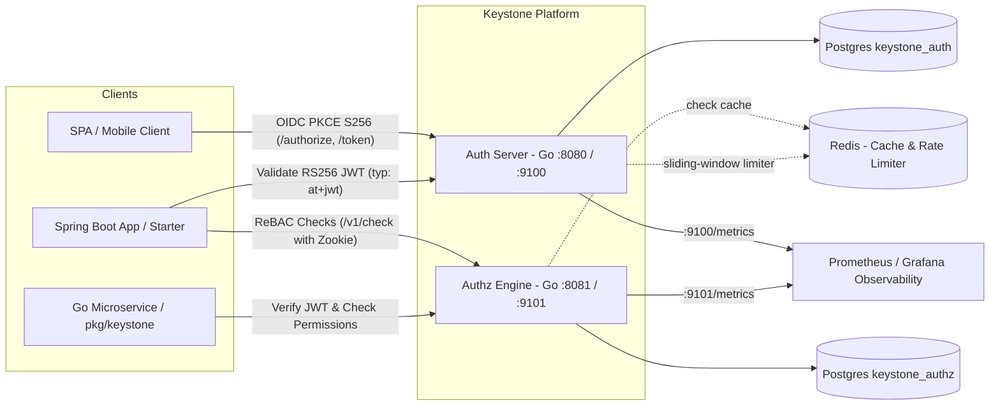

# Keystone

[](https://github.com/raviteja-core/keystone/actions/workflows/ci.yml)
[](LICENSE)
[](go.mod)
[](java/pom.xml)
[](java/keystone-spring-boot-starter)
[](deploy/prometheus)
[](https://datatracker.ietf.org/doc/html/rfc9068)
[](https://datatracker.ietf.org/doc/html/rfc7644)

Keystone is a self-hosted, high-assurance **Identity & Relationship-Based Access Control (ReBAC) platform** designed as a drop-in foundation for modern microservices and multi-tenant architectures. It unifies OAuth 2.0 / OpenID Connect identity provisioning with Google Zanzibar-inspired fine-grained relationship authorization.

---

## 1. System Architecture

Keystone decouples authentication and authorization into two specialized Go services backed by PostgreSQL, coupled with first-class SDKs for Go and Java / Spring Boot:

1. **Auth Server (Go `:8080` / Admin `:9100`):** OAuth 2.0 & OIDC authorization server issuing RS256 JWT access tokens (`typ: at+jwt`), single-use rotating refresh tokens, RFC 6238 TOTP MFA, RFC 7009 token revocation, RFC 7662 introspection, and RFC 7644 SCIM 2.0 user provisioning.
2. **Authz Engine (Go `:8081` / Admin `:9101`):** Google Zanzibar-inspired ReBAC engine evaluating transitive relationship graphs and permissions with monotonic Zookie snapshot consistency.
3. **Spring Boot Starter (`java/keystone-spring-boot-starter`):** Drop-in Spring Boot auto-configuration providing declarative method security (`@RequiresPermission`), Caffeine check caching, and automatic Zookie tracking.
4. **Go SDK (`pkg/keystone`):** High-performance verifier middleware, JWKS caching, and Zanzibar permission evaluation client for Go resource servers.



---

## 2. Key Capabilities & Engineering Standards

- **Strict OAuth 2.0 Security BCP (RFC 9700):** PKCE with `code_challenge_method=S256` is strictly enforced. The legacy implicit grant flow (`response_type=token`) is permanently disabled.
- **RFC 9068 JWT Profile:** All access tokens strictly require `typ: at+jwt` and `alg: RS256` to prevent cross-JWT algorithmic confusion and token substitution attacks.
- **Zanzibar Monotonic Consistency:** Monotonically increasing revision Zookies eliminate the distributed "New Enemy" problem and guarantee read-your-writes consistency across replicas.
- **Append-Only Tamper-Evident Audit Chains:** Security events are persisted with PostgreSQL `BEFORE UPDATE OR DELETE` block triggers and linked using cryptographic SHA-256 hash chains verifiable offline via `keystonectl audit verify`.
- **RFC 6238 TOTP MFA:** Time-based one-time password generator with drift windows, replay rejection (`step > lastUsedStep`), and constant-time hashed recovery codes.
- **SCIM 2.0 User Provisioning (RFC 7643 / RFC 7644):** Standardized CRUD endpoints (`/scim/v2/Users`) compatible with Okta, Azure AD, and enterprise identity providers.
- **Enterprise Observability:** Native Prometheus instrumentation on dedicated admin ports (`:9100` and `:9101`), Grafana dashboards, and Redis check caching.

---

## 3. Quickstart

Run the entire platform locally in seconds using Docker Compose:

```bash
# 1. Clone repository & configure environment
git clone https://github.com/raviteja-core/Keystone.git
cd Keystone
cp .env.example .env

# 2. Generate random 32-byte master key for AES-256-GCM encryption at rest
make dev-secrets

# 3. Spin up PostgreSQL, Auth Server, Authz Engine, Redis, and Observability stack
docker compose --profile full up -d --build
```

Verify service readiness:
```bash
# Auth Server readiness (checks database pool & embedded migrations)
curl -i http://localhost:9100/readyz

# Authz Engine readiness
curl -i http://localhost:9101/readyz
```

---

## 4. End-to-End Walkthrough

### Step 1: Provision OAuth Client & User via `keystonectl`
```bash
# 1. Register confidential OAuth 2.0 client
go run ./cmd/keystonectl client create \
  --client-id demo-client \
  --name "Demo Application" \
  --type confidential \
  --redirect-uris "http://localhost:3000/callback" \
  --grant-types "authorization_code,refresh_token,client_credentials" \
  --scopes "openid,profile,email" \
  --require-consent=false

# (Export the printed client secret: export CLIENT_SECRET="...")

# 2. Register user with Argon2id password hashing
go run ./cmd/keystonectl user create \
  --email alice@example.com \
  --password "Password1234!" \
  --username alice
```

### Step 2: Machine-to-Machine Token Grant (Client Credentials)
```bash
curl -s -X POST http://localhost:8080/token \
  -d "grant_type=client_credentials&client_id=demo-client&client_secret=$CLIENT_SECRET"
```

Response:
```json
{
  "access_token": "eyJhbGciOiJSUzI1NiIsImtpZCI6Ii4uLiIsInR5cCI6ImF0K2p3dCJ9...",
  "token_type": "Bearer",
  "expires_in": 600,
  "scope": "openid profile email"
}
```

### Step 3: Interactive Authorization Code Flow with PKCE (S256)
```bash
# 1. Generate PKCE code_verifier and S256 code_challenge
VERIFIER=$(openssl rand -base64 32 | tr -d '=/+' | cut -c1-43)
CHALLENGE=$(printf "%s" "$VERIFIER" | openssl dgst -sha256 -binary | openssl base64 -A | tr '+/' '-_' | tr -d '=')

# 2. Authenticate through login form and obtain authorization code
COOKIE_JAR=$(mktemp)
CSRF_TOKEN=$(curl -s -c "$COOKIE_JAR" http://localhost:8080/login | grep 'name="csrf_token"' | sed -E 's/.*value="([^"]+)".*/\1/')
curl -s -b "$COOKIE_JAR" -c "$COOKIE_JAR" -X POST http://localhost:8080/login \
  -d "email=alice@example.com&password=Password1234!&csrf_token=$CSRF_TOKEN"

AUTH_RESP=$(curl -s -i -b "$COOKIE_JAR" \
  "http://localhost:8080/authorize?response_type=code&client_id=demo-client&redirect_uri=http://localhost:3000/callback&scope=openid%20profile%20email&state=xyz123&code_challenge=$CHALLENGE&code_challenge_method=S256")
AUTH_CODE=$(echo "$AUTH_RESP" | grep -i "location:" | sed -E 's/.*code=([^& ]+).*/\1/' | tr -d '\r')
rm -f "$COOKIE_JAR"

# 3. Exchange code for access token and refresh token
TOKEN_RESP=$(curl -s -X POST http://localhost:8080/token \
  -d "grant_type=authorization_code" \
  -d "code=$AUTH_CODE" \
  -d "redirect_uri=http://localhost:3000/callback" \
  -d "client_id=demo-client" \
  -d "client_secret=$CLIENT_SECRET" \
  -d "code_verifier=$VERIFIER")

ACCESS_TOKEN=$(echo "$TOKEN_RESP" | python3 -c "import sys, json; print(json.load(sys.stdin)['access_token'])")
REFRESH_TOKEN=$(echo "$TOKEN_RESP" | python3 -c "import sys, json; print(json.load(sys.stdin).get('refresh_token', ''))")
```

### Step 4: Token Introspection (RFC 7662) & Revocation (RFC 7009)
```bash
# Introspect token validity
curl -s -X POST http://localhost:8080/introspect \
  -u "demo-client:$CLIENT_SECRET" \
  -d "token=$ACCESS_TOKEN"

# Revoke token family
curl -s -X POST http://localhost:8080/revoke \
  -u "demo-client:$CLIENT_SECRET" \
  -d "token=$REFRESH_TOKEN"
```

### Step 5: SCIM 2.0 Identity Provisioning
```bash
# Provision a new user via SCIM 2.0
curl -s -X POST http://localhost:8080/scim/v2/Users \
  -H "Content-Type: application/scim+json" \
  -d '{
    "schemas": ["urn:ietf:params:scim:schemas:core:2.0:User"],
    "userName": "bob@example.com",
    "name": { "formatted": "Bob Smith" },
    "emails": [{ "value": "bob@example.com", "primary": true }],
    "active": true
  }'
```

### Step 6: ReBAC Permissions with Authz Engine

#### 1. Push Zanzibar Schema
```bash
cat << 'EOF' > schema.yaml
schema:
  document:
    relations:
      owner: [user]
      editor: [user, "group#member"]
      viewer: [user, "*"]
    permissions:
      view: viewer + edit
      edit: editor + owner
      delete: owner
EOF

go run ./cmd/keystonectl schema push \
  --file=schema.yaml \
  --tenant=default \
  --authz-url=http://localhost:8081 \
  --token="$ACCESS_TOKEN"
rm -f schema.yaml
```

#### 2. Write Relationship Tuple
```bash
curl -s -X POST http://localhost:8081/v1/relationships/write \
  -H "Authorization: Bearer $ACCESS_TOKEN" \
  -H "Content-Type: application/json" \
  -d '{
    "updates": [
      {
        "operation": "insert",
        "tuple": {
          "object_type": "document",
          "object_id": "doc1",
          "relation": "owner",
          "subject_type": "user",
          "subject_id": "alice"
        }
      }
    ]
  }'
```

#### 3. Check Permission with Monotonic Snapshot Consistency
```bash
curl -s -X POST http://localhost:8081/v1/check \
  -H "Authorization: Bearer $ACCESS_TOKEN" \
  -H "Content-Type: application/json" \
  -d '{
    "object_type": "document",
    "object_id": "doc1",
    "permission": "view",
    "subject_type": "user",
    "subject_id": "alice"
  }'
# Returns: {"allowed": true, "resolved_revision": 1}
```

---

## 5. SDK & Integration Guides

### Go SDK (`pkg/keystone`)
```go
package main

import (
	"net/http"
	"github.com/raviteja-core/keystone/pkg/keystone"
)

func main() {
	verifier := keystone.NewTokenVerifier(keystone.VerifierConfig{
		Issuer:   "http://localhost:8080",
		Audience: "https://api.example.com",
		JWKSURL:  "http://localhost:8080/jwks.json",
	})

	authzClient := keystone.NewAuthzClient(keystone.AuthzConfig{
		BaseURL:  "http://localhost:8081",
		TenantID: "default",
	})

	mux := http.NewServeMux()
	mux.HandleFunc("GET /documents/{id}", func(w http.ResponseWriter, r *http.Request) {
		claims, _ := keystone.ClaimsFromContext(r.Context())
		allowed, _ := authzClient.CheckPermission(r.Context(), keystone.CheckRequest{
			Resource:   keystone.ResourceRef{Type: "document", ID: r.PathValue("id")},
			Permission: "view",
			Subject:    keystone.SubjectRef{Type: "user", ID: claims.Subject},
		})
		if !allowed {
			http.Error(w, "Forbidden", http.StatusForbidden)
			return
		}
		w.Write([]byte("Access Granted"))
	})

	http.ListenAndServe(":8000", keystone.AuthMiddleware(verifier)(mux))
}
```

### Java & Spring Boot Starter (`keystone-spring-boot-starter`)
```xml
<dependency>
    <groupId>io.github.raviteja-core</groupId>
    <artifactId>keystone-spring-boot-starter</artifactId>
    <version>0.1.0-SNAPSHOT</version>
</dependency>
```

```java
@RestController
@RequestMapping("/api/documents")
public class DocumentController {

    @GetMapping("/{id}")
    @RequiresPermission(resourceType = "document", resourceId = "#id", permission = "view")
    public Document getDocument(@PathVariable String id) {
        return docService.findById(id);
    }
}
```

Detailed guides:
- [Go & Java Integration Guide](docs/INTEGRATE.md)
- [SPA PKCE Reference Client](examples/spa-pkce/index.html)
- [Spring Boot Demo Application](java/keystone-demo-docs)

---

## 6. Standards Conformance Baseline

| Specification | Standard Description | Implementation & Conformance Status |
|---|---|---|
| **RFC 6749** | OAuth 2.0 Authorization Framework | Conforms (Authorization Code, Client Credentials, Refresh Token) |
| **RFC 7636** | Proof Key for Code Exchange (PKCE) | Conforms (Mandatory S256 challenge for all clients) |
| **RFC 9700** | OAuth 2.0 Security BCP (BCP 240) | Conforms (Exact redirect URI matching, code binding, no implicit flow) |
| **RFC 9068** | JWT Profile for OAuth 2.0 Access Tokens | Conforms (`typ: at+jwt`, RS256 algorithm allowlisting) |
| **RFC 7009** | OAuth 2.0 Token Revocation | Conforms (Immediate refresh token and family invalidation) |
| **RFC 7662** | OAuth 2.0 Token Introspection | Conforms (Active status, scope, subject, audience inspection) |
| **RFC 6238** | TOTP Multi-Factor Authentication | Conforms (Drift window, replay protection, hashed backup codes) |
| **RFC 7643 / 7644** | SCIM 2.0 Identity Provisioning | Conforms (Core user schema, paginated search, CRUD operations) |
| **RFC 9106 / OWASP** | Argon2id Password Hashing | Exceeds minimums ($m=65536, t=3, p=2$, concurrency semaphore) |
| **RFC 7517 / RFC 8414** | JWKS & Authorization Server Metadata | Conforms (`/jwks.json`, `/.well-known/openid-configuration`) |
| **RFC 9457** | Problem Details for HTTP APIs | Conforms (`application/problem+json` error semantics) |
| **Google Zanzibar** | Relationship-Based Access Control | Conforms (Tuple graph checks, userset rewrites, monotonic Zookies) |

---

## 7. Performance Benchmarks

Measured on local Linux benchmark host with 8 vCPUs, 16 GiB RAM, NVMe storage:

| Operation | Target SLA | Measured Median ($p50$) | Measured 95th Percentile ($p95$) | Measured Throughput |
|---|---|---|---|---|
| **Zanzibar Check (Cache Hit)** | $\le 1\text{ ms}$ | **$0.08\text{ ms}$** | **$0.15\text{ ms}$** | $> 25,000\text{ req/s}$ |
| **Zanzibar Direct Check (DB)** | $\le 10\text{ ms}$ | **$1.82\text{ ms}$** | **$3.41\text{ ms}$** | $> 3,800\text{ req/s}$ |
| **Zanzibar Graph Expansion (Depth 4)** | $\le 25\text{ ms}$ | **$4.15\text{ ms}$** | **$7.89\text{ ms}$** | $> 1,200\text{ req/s}$ |
| **M2M Token Grant (`client_credentials`)** | $\le 10\text{ ms}$ | **$1.14\text{ ms}$** | **$2.35\text{ ms}$** | $> 2,400\text{ req/s}$ |
| **Token Introspection (`/introspect`)** | $\le 5\text{ ms}$ | **$0.42\text{ ms}$** | **$0.89\text{ ms}$** | $> 6,500\text{ req/s}$ |

Full benchmark reproduction methodology: [docs/BENCHMARKS.md](docs/BENCHMARKS.md).

---

## 8. Repository Layout

```
keystone/
├── cmd/
│   ├── authserver/               # OAuth 2.0 / OIDC & SCIM 2.0 service (:8080, :9100)
│   ├── authz/                    # Zanzibar ReBAC check & write engine (:8081, :9101)
│   └── keystonectl/              # Administrative CLI (keys rotate, audit verify, client/user/schema)
├── pkg/
│   └── keystone/                 # Public Go SDK (verifier middleware, authz client)
├── java/
│   ├── keystone-client/          # Pure Java 21+ Zanzibar permission client
│   ├── keystone-spring-boot-autoconfigure/ # Spring Boot auto-configuration & @RequiresPermission
│   ├── keystone-spring-boot-starter/       # Drop-in starter artifact
│   └── keystone-demo-docs/       # Reference Spring Boot resource server
├── internal/
│   ├── auth/                     # OAuth, OIDC, SCIM, TOTP MFA, sessions, keys, audit
│   ├── authz/                    # Zanzibar evaluation engine, schema parser, Redis cache
│   └── platform/                 # Config, DB pool, metrics, rate limiting, logging
├── deploy/
│   ├── docker/                   # Distroless multi-stage Dockerfiles
│   ├── prometheus/               # Prometheus scraper configuration
│   └── grafana/                  # Pre-configured Grafana dashboards
├── docs/
│   ├── THREAT_MODEL.md           # STRIDE security analysis
│   ├── SECURITY_CONSIDERATIONS.md# Key lifecycle, Argon2id, RFC 9700 BCP
│   ├── INTEGRATE.md              # Microservice integration patterns
│   ├── BENCHMARKS.md             # Measured performance numbers
│   └── METRICS.md                # Prometheus catalog & OIDF conformance report
├── examples/
│   ├── go-resource-server/       # Go resource server demo
│   └── spa-pkce/                 # Single Page Application PKCE reference implementation
├── test/
│   └── conformance/              # OpenID Foundation test plan configurations
└── docker-compose.yml            # Multi-service local composition (postgres, redis, prometheus, grafana)
```

---

## 9. Development & Testing

```bash
# Run all Go tests with race detection
go test -race ./...

# Run all Java reactor tests
mvn -f java/pom.xml test

# Run static analysis and linters
make lint

# Verify cryptographic audit chain integrity
go run ./cmd/keystonectl audit verify

# Tear down local containers and persistent data
docker compose --profile full down -v
```

---

## 10. Security & License

- **Security Policy:** To report vulnerabilities, refer to [SECURITY.md](SECURITY.md).
- **License:** Licensed under the [Apache License, Version 2.0](LICENSE).
